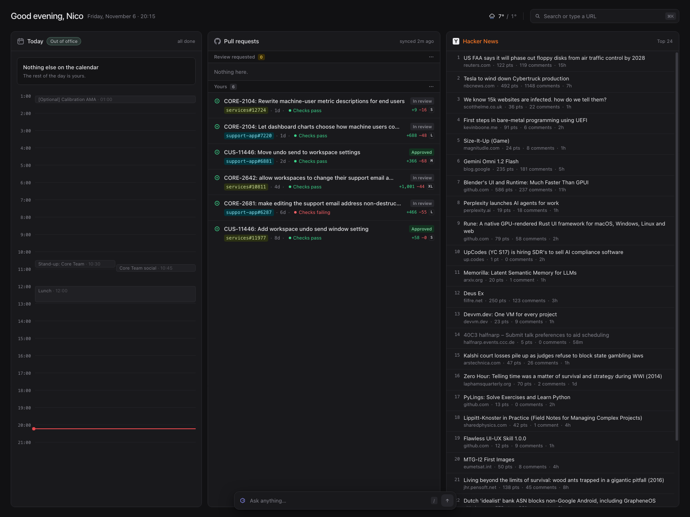

# browser-home



A new-tab page that runs on your own Mac. One glance shows:

- **Today**: your calendar as a timeline, with a countdown to the next meeting and a Join button.
- **Pull requests**: PRs waiting for your review, and your own, with CI status and size.
- **Hacker News**: the top stories, with a built-in threaded comment viewer.
- **Weather**: today's forecast for Berlin.
- **Quick question**: a chat box at the bottom that asks your local LLM.

It runs at `http://localhost:6464`. It needs no browser extension, no OAuth app, and no cloud service. It reuses logins you already have: the macOS Calendar app and the `gh` CLI. Only your own machine can reach it.

## Setup

You need macOS 14+, Node 24+, pnpm, the Xcode command line tools, and `gh` logged in.

1. Install, and build the small calendar helper:

   ```sh
   pnpm install
   pnpm build:agenda
   ```

2. Allow calendar access. Run this once and click **Allow** when macOS asks:

   ```sh
   ./bin/agenda
   ```

   It prints today's events. No prompt? Check System Settings → Privacy & Security → Calendars.

3. Optional: set up the chat box. Copy `.env.example` to `.env` and fill in your LLM's URL, model, and API key.

4. Build it, and start it at every login:

   ```sh
   pnpm build
   ./scripts/install-launchd.sh
   ```

5. Set it as your new-tab page. In Vivaldi: Settings → Tabs → New Tab Page → **Specific Page** → `http://localhost:6464`.

## Using it

| Key   | Does                                |
| ----- | ----------------------------------- |
| `⌘K`  | Search the web, or type a URL       |
| `/`   | Ask the local LLM                   |
| `Esc` | Hide the chat, or leave HN comments |

- Click **N comments** on a story to read the thread right in the HN column. Click `[–]` or a thread line to fold a branch.
- Links and searches open in a new tab, so this page stays put.
- The `…` menus in the PR column filter by repo, author, status, or checks. Filters are remembered.

## Settings

Edit `launchd/com.ndom91.browser-home.plist`, then re-run `./scripts/install-launchd.sh`.

| Setting  | Default                | What it does          |
| -------- | ---------------------- | --------------------- |
| `PORT`   | `6464`                 | Port the page runs on |
| `GH_BIN` | `/opt/homebrew/bin/gh` | Where `gh` lives      |

The chat settings (`LLM_BASE_URL`, `LLM_MODEL`, `LLM_API_KEY`) live in `.env`.

These also live in `.env`:

| Setting            | Default                            | What it does                                     |
| ------------------ | ---------------------------------- | ------------------------------------------------ |
| `GH_SEARCH_FILTER` | none                               | Extra GitHub search qualifiers, e.g. `org:acme`  |
| `LINEAR_WORKSPACE` | none                               | Linear workspace slug; links PRs to their issues |
| `VITE_SEARCH_URL`  | `https://www.google.com/search?q=` | Search engine; the query is appended to this URL |

Run `pnpm build` again after changing `VITE_SEARCH_URL`. It is baked into the page at build time.

## After updating

The page keeps running the old version until you rebuild and restart it:

```sh
pnpm build
launchctl kickstart -k gui/$(id -u)/com.ndom91.browser-home
```

## Troubleshooting

- **Calendar says "timed out" or "access denied".** Run `./bin/agenda` in a terminal and click Allow. Rebuilding the helper can make macOS ask again.
- **No pull requests.** Run `gh auth status`. Your org may need SSO authorized for the `gh` token.
- **Chat says "Missing LLM_…".** Create `.env` from `.env.example`, then restart.
- **Moved the repo or switched Node managers.** Re-run `./scripts/install-launchd.sh`.
- **Logs** are in `~/Library/Logs/browser-home.log`.

## Uninstall

```sh
launchctl bootout gui/$(id -u)/com.ndom91.browser-home
rm ~/Library/LaunchAgents/com.ndom91.browser-home.plist
```

Working on the code? See [AGENTS.md](AGENTS.md).
