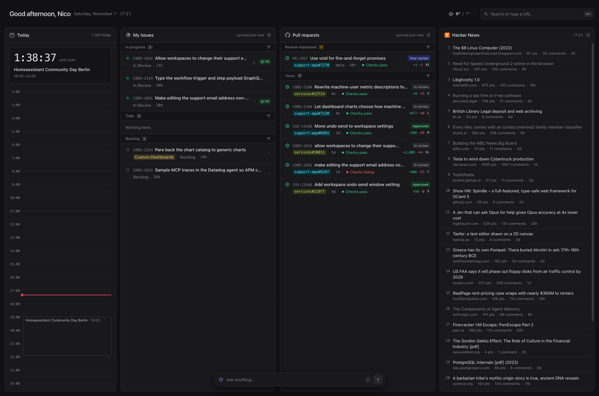

# browser-home



A new-tab page that runs on your own Mac. One glance shows:

- **Today**: your calendar as a timeline, with a countdown to the next meeting, a Join button, and how much free time is left in your workday. In the hour before a standup, it also lists what you finished, opened, and have in progress since the last one.
- **My issues** (optional): your Linear issues in progress, todo and backlog, with a chip when one of your PRs names the issue.
- **Pull requests**: PRs waiting for your review, and your own, with CI status and size. Small icons flag new comments or mentions, and review requests that sat for 3 hours. Click an icon to dismiss it. A dismissed comment icon is also marked read on GitHub.
- **Hacker News**: the top stories, with a built-in threaded comment viewer.
- **Weather**: today's forecast for Berlin.
- **Quick question** (optional): a chat box at the bottom that asks your local LLM.
- **Quick capture**: press `c` to add a bullet to this week's Obsidian note.

The tab title shows a count, like `(3) Home`, when PRs wait for your review, your own PRs fail CI, or a listed PR has unread activity.

The cog next to the search box opens **Settings**: light or dark theme, which columns show and in what order (drag the rows), and your workday hours.

It runs at `http://localhost:6464`. It needs no browser extension, no OAuth app, and no cloud service. It reuses logins you already have: the macOS Calendar app and the `gh` CLI. Only your own machine can reach it.

## Setup

You need macOS 14+, Node 24+, pnpm, the Xcode command line tools, and `gh` logged in.

1. Install, and build the small calendar helper:

   ```sh
   pnpm install
   pnpm build:agenda
   ```

2. Allow calendar access. Run this once and click **Allow** when macOS asks:

   ```sh
   ./bin/agenda
   ```

   It prints today's events. No prompt? Check System Settings → Privacy & Security → Calendars.

3. Optional: copy `config.example.yaml` to `config.yaml`, and `.env.example` to `.env`. Settings go in `config.yaml`. Secrets go in `.env`, and `config.yaml` reads them with `${VAR}`. The chat box needs your LLM's URL, model and API key. The Linear column needs an API key and your workspace slug. Each one stays hidden until its settings are there.

4. Build it, and start it at every login:

   ```sh
   pnpm build
   ./scripts/install-launchd.sh
   ```

5. Set it as your new-tab page. In Vivaldi: Settings → Tabs → New Tab Page → **Specific Page** → `http://localhost:6464`.

## Using it

Press `?` for the full list. The main ones:

| Key                | Does                                                  |
| ------------------ | ----------------------------------------------------- |
| `⌘K`               | Search the web, or type a URL                         |
| `1`–`4`, `h` / `l` | Jump to a column                                      |
| `j` / `k`, `↵`     | Move through rows, open one                           |
| `f` / `r`          | Filter the section / refresh the column               |
| `c`                | Quick capture to this week's note                     |
| `,`                | Settings                                              |
| `/`                | Ask the local LLM                                     |
| `Esc`              | Leave the column, hide the chat, or leave HN comments |

- Click **N comments** on a story to read the thread right in the HN column. Click `[–]` or a thread line to fold a branch.
- With the optional HN session configured, click the triangle below a story's rank to upvote without leaving the page. It turns orange after HN confirms the vote.
- Links and searches open in a new tab, so this page stays put.
- The filter icon on each PR and Linear section filters by repo, project, author, status and more. Active filters show as pills next to it, and filters are remembered.

## Settings

Edit `launchd/com.ndom91.browser-home.plist`, then re-run `./scripts/install-launchd.sh`.

| Setting  | Default                | What it does          |
| -------- | ---------------------- | --------------------- |
| `PORT`   | `6464`                 | Port the page runs on |
| `GH_BIN` | `/opt/homebrew/bin/gh` | Where `gh` lives      |

These live in `config.yaml`. See `config.example.yaml` for details. Edits apply on the next page load, with no restart:

| Setting                                    | Default                            | What it does                                                   |
| ------------------------------------------ | ---------------------------------- | -------------------------------------------------------------- |
| `llm.base_url`, `llm.model`, `llm.api_key` | none                               | The chat box. Hidden unless all three are set                  |
| `mcp.servers`                              | none                               | MCP servers whose tools the chat can call, e.g. Home Assistant |
| `linear.api_key`, `linear.workspace`       | none                               | The Linear column and PR-to-issue links. Hidden without both   |
| `capture.dir`                              | none                               | Folder of weekly notes for quick capture. Hidden without it    |
| `greeting_name`                            | your GitHub name                   | Name in the greeting                                           |
| `github.search_filter`                     | none                               | Extra GitHub search qualifiers, e.g. `org:acme`                |
| `search_url`                               | `https://www.google.com/search?q=` | Search engine; the query is appended to this URL               |

Set `BH_CONFIG` to keep the file somewhere other than the repo root.

### Hacker News voting (optional)

While logged in at `news.ycombinator.com`, open your browser's developer tools → Application (or Storage) → Cookies, and copy the value of the `user` cookie. Put that value alone in `.env` as `HN_SESSION_COOKIE`, then add this to `config.yaml`:

```yaml
hacker_news:
  session_cookie: ${HN_SESSION_COOKIE}
```

Restart the server after changing `.env` (`pnpm reload` for the installed service). The cookie grants access to your HN account; keep it in the gitignored `.env`. The local server fetches a fresh authenticated vote link for each click, sends the vote, and checks that HN recorded it. Neither the cookie nor the vote link reaches the browser. If the session expires, replace the cookie. Voting controls stay hidden unless `hacker_news.session_cookie` is set. Voting relies on HN's website markup because its public API has no write endpoints.

## After updating

The page keeps running the old version until you rebuild and restart it:

```sh
pnpm build
pnpm reload
```

`pnpm reload` restarts the launchd service. Run it alone after changing `.env`. `config.yaml` needs no restart.

## Troubleshooting

- **Calendar says "timed out" or "access denied".** Run `./bin/agenda` in a terminal and click Allow. Rebuilding the helper can make macOS ask again.
- **No pull requests.** Run `gh auth status`. Your org may need SSO authorized for the `gh` token.
- **No chat box, Linear column or quick capture.** Its settings are missing from `config.yaml`, or a `${VAR}` it uses is missing from `.env`. The log names what's missing.
- **Quick capture fails.** Check that `capture.dir` exists. The first capture of a week also needs `template.md` in it.
- **Moved the repo or switched Node managers.** Re-run `./scripts/install-launchd.sh`.
- **Logs** are in `~/Library/Logs/browser-home.log`.

## Uninstall

```sh
launchctl bootout gui/$(id -u)/com.ndom91.browser-home
rm ~/Library/LaunchAgents/com.ndom91.browser-home.plist
```

Working on the code? See [AGENTS.md](AGENTS.md).
